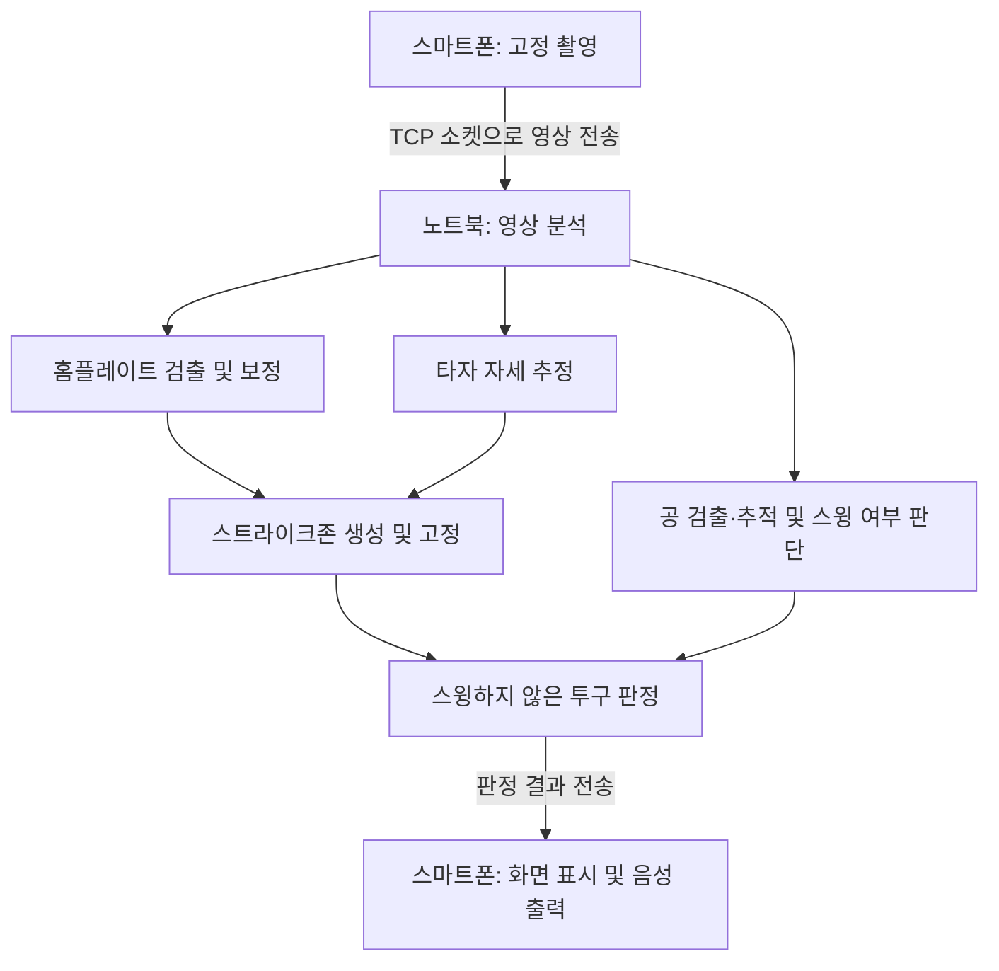

# strikezone-abs-mobile

팀 작업 절차와 브랜치·리뷰 규칙은 [협업 가이드](CONTRIBUTING.md)를 참고하세요.

### 스마트폰을 이용한 사회인야구 ABS 판독기 · 스트존

스마트폰 영상에서 **홈플레이트와 타자의 자세를 분석해 스트라이크존을 자동 생성**하고, 스윙하지 않은 투구의 **볼·스트라이크 판정 결과를 음성으로 전달**하는 프로젝트입니다.

고가의 전용 장비 없이 사회인야구 경기와 연습에서 활용할 수 있는 판정 보조 시스템을 목표로 합니다.

> 이 README는 팀프로젝트 제안서를 바탕으로 작성한 개발 계획입니다. 아래 기능과 성능 수치는 구현 범위 및 목표이며, 달성한 결과를 의미하지 않습니다. 스마트폰 단독 판정이 아닌 **스마트폰 + 노트북** 구성을 사용합니다.

## 프로젝트 개요

| 항목 | 내용 |
| --- | --- |
| 프로젝트명 | 스마트폰을 이용한 사회인야구 ABS 판독기 |
| 서비스명 | 스트존 |
| 대상 | 사회인야구 팀, 선수, 심판 및 리그 운영자 |
| 수행 기간 | 2026.09.26 ~ 2026.12.14 |
| 팀 | 3조 |
| 기본 구성 | 삼각대에 고정한 스마트폰 1대 + 영상 분석용 노트북 |

## 기획 배경

사회인야구에서는 전용 투구 추적 장비의 비용과 설치 부담 때문에 자동 판정 시스템을 활용하기 어렵습니다. 사람의 판정에 이견이 생겨도 투구 위치를 확인할 근거가 부족할 수 있습니다.

스트존은 화면 속 홈플레이트와 타자의 관절 위치를 기준으로 스트라이크존을 생성합니다. 거리·카메라 높이·타자 키를 직접 입력하는 부담을 줄이고, 투구 직후 판정 결과를 음성으로 전달하는 것을 목표로 합니다.

## 주요 기능 계획

### 1. 홈플레이트 자동 검출 및 보정

- OpenCV의 색상 변환, 이진화, 형태학 연산, 윤곽선 분석으로 홈플레이트를 검출합니다.
- 홈플레이트의 규격 폭 **43.18cm**를 화면 내 크기 기준으로 활용합니다.
- Homography와 홈플레이트·공의 크기 비율을 활용해 위치 보정 및 판정 시점 추정을 구현하고 검증합니다.

### 2. 타자 맞춤형 스트라이크존 생성

- YOLO Pose로 타자의 어깨·엉덩이·무릎 위치를 추정합니다.
- 투구 직전 준비 자세를 기준으로 존 높이를 계산합니다.
- 투구 시 존을 고정하여 스윙이나 스트라이드로 인한 자세 변화의 영향을 줄입니다.

### 3. 야구공 검출·추적 및 판정

- YOLO로 야구공을 검출하고 프레임 차분과 궤적 보간으로 이동 경로를 추적합니다.
- 홈플레이트 대비 공의 크기 비율을 이용해 공이 홈플레이트 앞면에 도달하는 시점을 추정합니다.
- 스윙 여부를 먼저 판단하고, **스윙하지 않은 투구**를 대상으로 볼·스트라이크를 판정합니다.
- 공을 놓쳐 판정할 수 없는 투구는 **판정 불가**로 처리합니다.

### 4. 실시간 화면·음성 출력

- 스마트폰에서 촬영한 영상을 노트북으로 전송합니다.
- 노트북에서 분석한 스트라이크존과 판정 결과를 스마트폰에 전달합니다.
- Android TextToSpeech 또는 녹음 음성으로 **STRIKE / BALL**을 출력합니다.

## 시스템 구성



고속 촬영 영상의 전송 부담을 줄이기 위해 **존 표시용 영상**과 **투구 분석용 구간 영상**을 나누어 전송하는 방안을 검토합니다. 현재는 폰 1대를 기준으로 단일 카메라의 깊이·통과 시점 추정 한계를 검증합니다.

## 기술 스택 계획

| 영역 | 기술 | 용도 |
| --- | --- | --- |
| 영상 분석·판정 | Python | 노트북 분석 서버 및 판정 로직 |
| 영상 처리 | OpenCV | 홈플레이트 검출, Homography, 프레임 차분 |
| 자세 추정 | Ultralytics YOLO Pose | 타자 관절 추정 및 존 높이 계산 |
| 객체 검출 | YOLO | 야구공 검출 |
| 모델 학습 | 로컬 GPU | 야구공 검출 모델 학습 |
| 모바일 앱 | Kotlin / Android | 카메라 촬영, 영상 전송, 결과 표시 |
| 통신 | TCP Socket | 스마트폰과 노트북 간 영상·결과 전송 |
| 음성 출력 | Android TextToSpeech 또는 녹음 음성 | STRIKE / BALL 안내 |

## 개발 범위

**포함하는 범위**

- 삼각대에 고정한 스마트폰 1대의 고속 촬영 영상(120~240fps)
- 홈플레이트 및 타자 자세 기반 스트라이크존 자동 생성
- 스윙 여부 판단과 스윙하지 않은 투구의 볼·스트라이크 판정
- 스마트폰 촬영 → 노트북 분석 → 스마트폰 화면·음성 출력

**이번 프로젝트에서 제외하는 범위**

- 프로야구 중계 영상 판정
- 손으로 들고 촬영한 흔들리는 영상
- 구속·회전 등 투구 특성 분석
- 노트북 없이 스마트폰만으로 처리하는 판정
- 반스윙·바운드 공 등 규칙상 예외 판정

## 성능 목표 및 검증 방법

| 평가 항목 | 목표 | 검증 방법 |
| --- | --- | --- |
| 홈플레이트 자동 검출 | 성공률 90% 이상 | 직접 촬영한 영상에서 검출 성공 여부 측정 |
| 스트라이크존 경계 | 상·하단 경계 평균 오차 5cm 이내 | 사람이 표시한 정답 존과 비교 |
| 볼·스트라이크 판정 | 100구 이상 평가, 정확도 80% 이상 | 홈플레이트 앞면 타겟 프레임 기준 정답과 비교 |
| 실시간 존 표시 | 10fps 이상 | 스마트폰 → 노트북 전송 환경, 노트북 CPU 기준 측정 |
| 판정 음성 지연 | 투구 후 2초 이내 | 투구부터 스마트폰 음성 출력까지 소요 시간 측정 |

카메라 위치와 조명 조건을 달리하여 데이터를 수집하고, **Pose 기반 존과 키 비율 기반 존**을 비교합니다. 고속 촬영 프레임률과 실시간 존 표시 프레임률은 별도의 지표로 평가합니다.

## 팀원 및 역할

| 이름 | 역할 | 주요 담당 |
| --- | --- | --- |
| 박평준 | 팀장 / 존 생성 | 일정 관리, 회의 진행, 최종 취합, Pose 기반 존 높이 계산 및 투구 직전 존 고정 |
| 이은주 | 영상 처리 / 판정 | 홈플레이트 검출, Homography, 공 크기 비율 기반 판정 시점 계산, 볼·스트라이크 판정 로직 |
| 최강 | 데이터 / 딥러닝 | 촬영 가이드, 영상 촬영·정답 라벨링, YOLO 공 검출 학습, 정확도 평가 |
| 주연우 | 앱 / 실시간 연동 | 안드로이드 촬영·음성 출력 앱, 스마트폰·노트북 소켓 통신, 실시간 시연 구성 |

## 추진 일정

아래 일정은 2026년 팀프로젝트 제안서 기준 계획입니다.

| 기간 | 단계 | 주요 내용 |
| --- | --- | --- |
| 09.26 ~ 10.10 | 주제 선정·기획 | 주제 확정, 제안서 작성, 기존 앱·선행 연구 조사 |
| 10.11 ~ 10.19 | 데이터·존 생성 | 촬영 가이드, 영상 촬영, 홈플레이트 검출, Pose 기반 존 생성 |
| 10.20 ~ 10.26 | 중간 점검 | 존 자동 생성 프로토타입 시연 및 피드백 반영 |
| 10.27 ~ 11.22 | 판정 기능 개발 | 공 검출·추적, 판정 시점 계산, 볼·스트라이크 판정 |
| 11.23 ~ 11.30 | 실시간 연동 | 앱·노트북 통신, 실시간 판정 및 음성 출력 연동 |
| 12.01 ~ 12.07 | 평가·개선 | 정확도·지연 시간 측정, 존 생성 방식·카메라 구성 비교, 오류 분석 |
| 12.08 ~ 12.14 | 마무리·발표 | 보고서·소스코드 정리, 실시간 판정 시연 |

## 최종 산출물

- Python 기반 노트북 영상 분석·판정 서버
- Kotlin 기반 안드로이드 촬영·화면·음성 출력 앱
- 직접 촬영·라벨링한 투구 영상 데이터셋
- 실시간 판정 시연 영상
- 최종 보고서 및 발표 자료

## 프로젝트 구조

현재 환경 확인용 Android 앱과 영상·모델 검사 스크립트를 제공합니다. 촬영·통신·판정 기능은 구현 전입니다. 모델 학습은 로컬 GPU에서 진행하고 Colab은 필수가 아닙니다.

```text
android/                  # Kotlin 촬영·화면·음성 앱
server/
  src/strikezone/
    pose/                 # 타자 자세·존 높이
    plate/                # 홈플레이트 검출·보정
    ball/                 # 공 검출·추적
    judgment/             # 판정·투구 상태
    transport/            # 앱 통신
    common/               # 공유 데이터 형식·유틸리티
  tests/                  # 단위·통합 검증
  requirements.txt        # Python 직접 의존성 버전
experiments/              # 로컬 GPU 학습·실험
configs/                  # 공유 설정 예시
data/                     # 영상·라벨 안내
models/                   # 가중치·모델 버전 안내
docs/                     # 통신·좌표 설계
.github/                  # Issue·PR 템플릿
```

| 시작 위치 | 안내 |
| --- | --- |
| [Android 앱](android/README.md) | 앱 역할과 개발 환경 구성 범위 |
| [Python 서버](server/README.md) | 모듈별 책임과 공통 코드 위치 |
| [학습·실험](experiments/README.md) | 로컬 GPU 학습과 실험 기록 |
| [설계 문서](docs/README.md) | 미확정 통신·좌표 규격의 합의 항목 |
| [데이터](data/README.md) / [모델](models/README.md) | 저장·버전 관리 안내 위치 |

## 실행 안내

[개발 환경 안내](docs/development.md)에 Python CPU/GPU 설치, 영상·모델 검사, Android 빌드·실기기 실행 절차를 정리했습니다. [검증 기록](docs/environment-validation.md)에서 실제 확인 범위를 확인하세요.

## 데이터 및 모델 관리

[관리 규칙](docs/data-management.md)에 로컬 배치·라벨·분할·버전 기준을 정리했습니다. 팀 외부 공유 위치는 미정이며 실제 영상·라벨·가중치는 Git에서 제외합니다.
