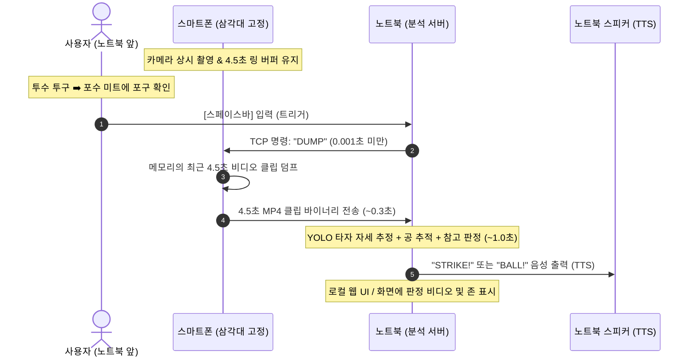

# 링 버퍼 및 노트북 트리거 기반 실시간 판정 아키텍처

작성일: 2026-11-11  
상태: 제안 및 확정 설계  

스마트폰과 노트북의 역할을 명확히 분리하여 **스마트폰은 고속 촬영 및 링 버퍼 전송 전용 장비**로 동작하고, **투구 트리거·영상 수신·AI 판정·음성(TTS) 출력을 모두 노트북에서 단독 완결**하는 시스템 설계 문서입니다.

---

## 1. 핵심 설계 방향: 스마트폰 역할의 극소화

기존 제안서의 `스마트폰 촬영 ➡️ 노트북 분석 ➡️ 스마트폰 결과 수신 ➡️ 스마트폰 음성 출력` 방식은 실시간 연동 복잡도와 네트워크 왕복 지연을 증가시켰습니다. 이를 다음과 같이 단순화합니다.

- **스마트폰:** 삼각대에 고정되어 카메라 프리뷰 및 **최근 4.5초 링 버퍼(Circular Buffer)**만 메모리에 유지. 결과 수신, UI 표시, 음성 출력 기능을 모두 제거하여 앱 복잡도 최소화.
- **노트북:** 
  1. 포수가 공을 포구하는 것을 보고 사용자가 `스페이스바` 클릭 (트리거).
  2. 스마트폰에 클립 전송 명령 송신.
  3. 전송받은 4.5초 영상을 기존 파이프라인으로 분석.
  4. 판정 결과 도출 즉시 **노트북 스피커(또는 외장 블루투스 스피커)로 "STRIKE" / "BALL" 음성 직접 출력**.

---

## 2. 전체 시스템 흐름



---

## 3. 4.5초 링 버퍼(Circular Buffer) 메커니즘

### 3.1 원리
- 카메라가 캡처하는 비디오 프레임을 스마트폰 RAM(메모리) 상의 원형 버퍼(FIFO 방식 덮어쓰기)에 상시 보관합니다.
- 버퍼 길이는 **4.5초**로 고정되며, 4.5초를 초과한 가장 오래된 프레임은 자동으로 메모리에서 폐기(Overwrite)됩니다.
- 내부 저장소(스토리지)에 쓰지 않으므로 스마트폰 발열과 I/O 병목이 발생하지 않습니다.

### 3.2 메모리 점유율 계산
- 해상도: 1080p (1920×1080), 60fps~120fps H.264 인코딩 스트림 기준
- 4.5초 영상의 압축 비트레이트 15~20Mbps 가정 시:
  $$\text{메모리 사용량} = \frac{20\,\text{Mbps} \times 4.5\,\text{s}}{8} \approx 11.25\,\text{MB}$$
- 스마트폰 RAM 사용량은 **15MB 내외**에 불과하여 매우 가볍고 안정적입니다.

---

## 4. 노트북 트리거의 유효성 검증 (영상이 잘리지 않는 근거)

### 4.1 "포구 후 컴퓨터에서 누르면 앞부분(와인드업)이 잘리지 않는가?"

**결론: 전혀 잘리지 않으며, 약 1.5초 이상의 충분한 안전 마진(Safety Margin)이 존재합니다.**

#### 투구 동작 타임라인 분석 (사회인야구 100km/h 기준)
1. **투수 셋포지션 / 와인드업:** 약 1.0 ~ 1.5초
2. **공 릴리스 ➡️ 홈플레이트 도달 (18.44m 비행 시간):**
   - $100\,\text{km/h} \approx 27.78\,\text{m/s}$
   - 비행 시간: 약 **0.66초**
3. **포구 순간 ➡️ 사람의 시각 인지 및 스페이스바 입력:**
   - 인간의 시각 반응 시간: 약 **0.3 ~ 0.4초**
4. **노트북 ➡️ 스마트폰 TCP 트리거 신호 전달:**
   - 로컬 Wi-Fi(LAN) 핑 지연: **0.001 ~ 0.003초 (1~3ms)**

#### 버퍼 보존 시간 계산
- **전체 투구 시작부터 트리거 신호 수신까지 걸린 시간:**
  $$1.5\text{초 (와인드업)} + 0.66\text{초 (비행)} + 0.4\text{초 (반응 및 통신)} = \mathbf{2.56\text{초}}$$
- **4.5초 링 버퍼 내 잔여 여유 시간 (Margin):**
  $$4.5\text{초} - 2.56\text{초} = \mathbf{+1.94\text{초}}$$

즉, 포수가 공을 잡은 뒤 사용자가 **약 1.5~1.9초 동안 멍때리거나 늦게 눌러도**, 투수가 와인드업을 시작하는 첫 프레임부터 버퍼 내에 온전히 보존됩니다.

---

## 5. 노트북 트리거 및 단독 출력의 핵심 이점

1. **카메라 물리적 각도 왜곡 원천 차단 (가장 중요)**
   - 삼각대에 거치된 스마트폰 화면을 손으로 터치하면 미세한 진동과 각도 틀어짐이 발생합니다.
   - 단일 카메라 좌표계에서는 카메라가 1도만 틀어져도 홈플레이트 수동 좌표와 스트라이크존이 완전히 어긋납니다. 스마트폰을 전혀 만지지 않는 구조가 판정 정밀도를 보장합니다.
2. **스마트폰 앱 구현 난이도 대폭 축소**
   - 안드로이드 앱에 결과 렌더링 오버레이, 소켓 결과 수신 리스너, Android TextToSpeech(TTS) 모듈을 탑재할 필요가 없습니다.
   - 앱은 오직 "카메라 오픈 ➡️ 버퍼 유지 ➡️ DUMP 수신 시 바이트 전송" 기능만 수행합니다.
3. **네트워크 왕복(RTT) 및 지연 시간 단축**
   - `노트북 ➡️ 스마트폰 결과 전송` 과정이 생략되므로 네트워크 병목이 줄어듭니다.
   - 노트북에서 판정 완료 즉시 Python의 `pyttsx3` 또는 사운드 라이브러리를 통해 0초 지연으로 음성이 출력됩니다.

---

## 6. 통신 프로토콜 명세 (간소화)

- **전송 계층:** TCP Socket
- **포트:** 기본 `9999`
- **방향성:** 
  - 노트북 ➡️ 스마트폰: 제어 명령 (단문)
  - 스마트폰 ➡️ 노트북: 비디오 바이너리 스트림 (단방향)

### 6.1 제어 패킷 (노트북 ➡️ 스마트폰)
ASCII 문자열 기반 단순 커맨드:
```text
DUMP 4.5\n
```
- `DUMP`: 현재 시점 기준 직전 4.5초 버퍼를 MP4로 인코딩하여 전송하라는 명령.

### 6.2 데이터 패킷 (스마트폰 ➡️ 노트북)
헤더 4바이트(파일 크기) + MP4 페이로드 구조:
```text
+-----------------------+------------------------------------------+
|  Payload Size (4 B)   |         MP4 Video File Payload           |
| (Big-Endian UInt32)   |              (N Bytes)                   |
+-----------------------+------------------------------------------+
```
1. 스마트폰은 4.5초 클립 크기 $N$을 4바이트 정수로 먼저 전송.
2. 이어 $N$ 바이트의 MP4 바이너리 데이터를 노트북으로 스트리밍.
3. 전송 완료 후 소켓 연결 유지 (다음 투구 대기).

---

## 7. 권장 네트워크 환경

1. **무선 공유기 (5GHz AP) 환경 (가장 권장):**
   - 인터넷 연결(외부망) 없이 전원만 연결된 공유기를 설치.
   - 노트북과 스마트폰 모두 해당 5GHz Wi-Fi에 접속.
   - 전송 속도: 300~500Mbps 이상 (10MB 영상 전송에 약 0.2~0.3초 소요).
   - 대형 안테나와 안정적인 전원 공급으로 핑(Ping) 튀김이나 발열 스로틀링 없이 가장 신뢰성 높음.
2. **스마트폰 모바일 핫스팟 (야외 실전 간편 구성):**
   - 별도 공유기나 콘센트 전원이 없는 야외 야구장에서 가장 간편한 방식.
   - 스마트폰에서 **모바일 핫스팟(5GHz 대역 권장)**을 켜고, 노트북을 해당 핫스팟 Wi-Fi에 접속.
   - 외부 인터넷(LTE/5G 데이터)을 소모하지 않고 폰과 노트북 간 1:1 로컬 Wi-Fi(LAN)로 직접 통신.
   - 지연 시간 1~3ms, 전송 속도 150~300Mbps 수준으로 4.5초 클립을 0.3~0.5초 내 전송 가능.
3. **USB 테더링 / 유선 케이블 환경 (극단적 전파 간섭 시 차선책):**
   - 전파 간섭이 극심한 환경일 경우 스마트폰과 노트북을 USB C-to-C로 연결 후 TCP 포트 포워딩(`adb forward tcp:9999 tcp:9999`) 사용.
   - 지연 시간 0ms, 전송 속도 기가비트급 보장.

---

## 8. 지연 시간(Latency) 예상 요약

| 단계 | 소요 시간 | 비고 |
| --- | --- | --- |
| 스페이스바 입력 ➡️ 스마트폰 명령 수신 | ~0.003초 | 로컬 LAN 패킷 전송 |
| 4.5초 클립 비디오 인코딩 및 전송 | ~0.35초 | 1080p H.264 (~8MB) 5GHz 전송 |
| 노트북 프레임 순차 디코딩 & YOLO 판정 | ~1.10초 | PyTorch GPU / 배칭 추론 |
| 노트북 로컬 TTS 음성 출력 ("STRIKE!") | ~0.05초 | 노트북 스피커 즉시 재생 |
| **총 소요 시간** | **약 1.5초** | **목표치(2초 이내) 완벽 충족** |
